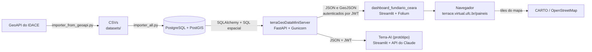

# Plano de treinamento da Plataforma Terra.Ce

Roteiro para formar quem vai desenvolver e manter a plataforma. Ele cobre o
domínio fundiário e as tecnologias, técnicas e conceitos usados no
`terraGeoDataMiniServer`, no `dashboard_fundiario_ceara` e no `terra_ai`.

- **Base:** versão 1.2.0 dos dois submódulos (superprojeto em `9897bd2`), levantada em 12/10/2026.
- **Público:** bolsistas e desenvolvedores que chegam ao projeto. O plano pressupõe Python básico (funções, classes, módulos) e uso do terminal.
- **Duração sugerida:** 12 semanas, de 8 a 10 horas por semana. Quem já domina um tema pode fazer só a prática do módulo e seguir.
- **Material didático:** o site com textos, exercícios autocorrigidos e o manual de contribuição está em [`treinamento-terra-digital/`](treinamento-terra-digital/README.md).

## Como usar

Cada módulo traz objetivo, conteúdo, onde o assunto aparece no código, uma
prática e referências. As práticas usam o próprio repositório e rodam na máquina
local, sem acesso à produção. A entrega de cada semana é curta: um notebook, um
commit numa branch de estudo ou uma resposta escrita, revisada por alguém da
equipe.

### Regras de segurança durante o treinamento

- Os CSVs de `terraGeoDataMiniServer/datasets/` não estão no Git (`*.csv` é
  ignorado) e trazem nomes de pessoas físicas. Peça os arquivos à coordenação,
  mantenha-os só na máquina de trabalho e não os envie para repositórios
  pessoais, nuvens particulares ou ferramentas de IA externas.
- Use segredos de mentira. Gere um `JWT_SECRET` local com
  `python -c "import secrets; print(secrets.token_urlsafe(48))"`. Nunca copie
  valores da stack de produção.
- Deixe `CARTO_API_KEY` vazia em `localhost`. A chave só vale para
  `terrace.virtual.ufc.br`, e sem ela o mapa usa o OpenStreetMap, que é o
  comportamento esperado.
- Não altere a stack do Portainer nem as imagens do Docker Hub. Os exercícios de
  implantação usam containers locais.

## 1. A aplicação em uma página



| Peça | O que faz | Tecnologias principais |
|---|---|---|
| Importadores (`terraGeoDataMiniServer/importer_*.py`) | Coletam a malha fundiária na GeoAPI do IDACE e carregam os CSVs no Postgres, uma transação por tabela | requests, tenacity, pandas, SQLAlchemy, PostGIS |
| `terraGeoDataMiniServer` | API somente leitura: regiões, municípios, lotes, GeoJSON simplificado, assentamentos, reservatórios e versão dos dados | FastAPI, Pydantic Settings, SQLAlchemy, PyJWT, Gunicorn + Uvicorn |
| `dashboard_fundiario_ceara` | Painéis públicos: gráficos, predominância, malha fundiária, concentração (Gini), assentamentos, hidrografia e escolas do campo | Streamlit, Folium, GeoPandas, pandas, matplotlib |
| `terra_ai` | Assistente em linguagem simples que consulta o miniserver por meio de ferramentas | Streamlit, SDK da Anthropic (tool use) |
| Infraestrutura | Imagens no Docker Hub, stack no Portainer, rede `terra_network`, CI do dashboard no GitHub Actions | Podman/Docker, Compose, Portainer, GitHub Actions |

Uma visita, do começo ao fim: o navegador abre uma página do dashboard; o
Streamlit pede os dados ao miniserver com um token JWT; o miniserver consulta o
PostGIS, oculta os nomes de pessoas físicas (LGPD) e devolve JSON comprimido; o
dashboard guarda a resposta em cache por até 24 horas e monta o mapa com o
Folium.

## 2. Mapa de conhecimentos

| Área | Tecnologias e conceitos | Onde ver |
|---|---|---|
| Domínio | malha fundiária, imóvel e lote, módulo fiscal, situação jurídica, assentamento, região administrativa, Índice de Gini | `dashboard_fundiario_ceara/modules/classificacao.py`, `paginaConcentracao.py`, `terra_ai/modules/terra_ai_glossario.py` |
| Python para dados | pandas 3, numpy, vetorização, `groupby`, `np.select` | `classificacao.py`, `paginaConcentracao.py`, `repositorio.py` |
| Geoprocessamento | geometrias, WKT/WKB/EWKB, GeoJSON, SRID 4326, 4674 e 31984, simplificação, índice GIST | `importer_all.py`, `data_service/main.py`, `config.py` |
| Banco de dados | PostgreSQL, PostGIS, SpatiaLite, transações, `ON CONFLICT`, `pg_dump` | `importer_all.py`, `IMPLANTACAO_PORTAINER.md` |
| Backend | FastAPI, injeção de dependências, middlewares, lifespan, Pydantic Settings, SQLAlchemy Core, Gunicorn | `data_service/main.py`, `config.py`, `entrypoint.sh` |
| Frontend de dados | Streamlit (reexecução do script, `session_state`, cache), Folium, streamlit-folium, matplotlib | `dashboard_fundiario_ceara/app.py`, `modules/` |
| Segurança | JWT (HS256, `exp`, `iat`, `aud`, `iss`), segredos no ambiente, rotação, escape de HTML, CORS, container sem root | `apiCliente.py`, `config.py` dos dois projetos, `doc/rotacao_segredos.md` |
| Privacidade | LGPD, minimização, pseudonimização por HMAC-SHA256, defesa em camadas | `privacidade.py` dos dois projetos |
| Engenharia de dados | ETL, idempotência, retry com backoff, versão das cargas, invalidação de cache | `importer_from_geoapi.py`, `importer_all.py`, `/versao_dados`, `repositorio.py` |
| Testes e qualidade | pytest, fixtures, `requests-mock`, `TestClient`, `AppTest`, ruff, convenção de nomes, dependências fixadas | `tests/` dos dois projetos, `ruff.toml`, `scripts/` |
| Implantação | Dockerfile, Podman, Compose, healthcheck, volume e rede externos, Portainer, Docker Hub, GitHub Actions | `Dockerfile.*`, `docker-compose.stack.yml`, `.github/workflows/testes.yml` |
| IA aplicada | API de mensagens, prompt de sistema, ferramentas, cache de prompt, respostas ancoradas nos dados | `terra_ai/modules/terra_ai_agent.py`, `terra_ai_tools.py` |
| Documentação | requisitos como user stories, PlantUML, OpenAPI, roteiros de operação | `doc/*.puml`, `terraGeoDataMiniServer/doc/spec.yaml`, READMEs |

## 3. Trilhas por perfil

Todos fazem os módulos da coluna **Base**. Depois, cada perfil aprofunda o que
mais vai usar.

| Módulo | Base | Dados e painéis | Backend e banco | Infraestrutura | IA |
|---|:-:|:-:|:-:|:-:|:-:|
| M0 Domínio fundiário | ● | | | | |
| M1 Ambiente e Git | ● | | | | |
| M2 Python para dados | ● | | | | |
| M3 Geoprocessamento | ● | | | | |
| M4 PostgreSQL e PostGIS | | ○ | ● | ○ | |
| M5 API com FastAPI | | ○ | ● | ○ | ○ |
| M6 Segurança | ● | | | | |
| M7 Streamlit | | ● | ○ | | ● |
| M8 Mapas e gráficos | | ● | | | |
| M9 Engenharia de dados | | ○ | ● | ○ | |
| M10 Desempenho e cache | | ● | ● | ○ | |
| M11 Testes | ● | | | | |
| M12 Qualidade e documentação | ● | | | | |
| M13 LGPD | ● | | | | |
| M14 Containers e implantação | | ○ | ○ | ● | |
| M15 Integração contínua | | | ○ | ● | |
| M16 Terra-AI | | | | | ● |

● obrigatório · ○ recomendado

## 4. Cronograma sugerido

| Semana | Módulos | Entrega |
|---|---|---|
| 1 | M0, M1 | Ambiente montado, as duas suítes de testes passando e glossário do domínio |
| 2 | M2 | Notebook com a classificação por módulo fiscal e o Gini calculados à mão e pelo código |
| 3 | M3 | Notebook comparando sistemas de referência e tolerâncias de simplificação |
| 4 | M4 | Arquivo `.sql` com as consultas da prática e os planos de execução |
| 5 | M5, M6 | Endpoint novo no miniserver, com teste, numa branch de estudo |
| 6 | M7, M8 | Página nova no dashboard, coberta pelo teste de fumaça |
| 7 | M9, M13 | Relatório da carga repetida duas vezes e análise da regra de privacidade |
| 8 | M10, M11 | Medições de cache e compressão; testes novos |
| 9 | M12, M14 | Stack completa em containers locais; um diagrama atualizado |
| 10 | M15, M16 | Workflow de CI do miniserver; avaliação do Terra-AI (perfil IA) |
| 11 e 12 | Projeto integrador | Pull request revisado e apresentação de 15 minutos |

## 5. Módulos

### M0 — O domínio fundiário e o projeto

**Objetivo.** Entender que perguntas a plataforma responde e o vocabulário dos dados.

**Conteúdo.**
- O Projeto Cientista Chefe Terra (IDACE, UFC e Funcap) e o papel do IDACE na regularização fundiária.
- Malha fundiária, imóvel, lote, número do INCRA, título, situação jurídica e categoria.
- Módulo fiscal e a classificação dos imóveis: pequena propriedade até 4 MF e
  média de 4 a 15 MF, segundo a Lei 8.629/1993; acima de 15 MF, grande. A
  faixa abaixo de 1 MF é um recorte adotado pelo projeto.
- Concentração fundiária, Índice de Gini e curva de Lorenz.
- Assentamentos da reforma agrária, reservatórios monitorados, escolas do campo e regiões administrativas do Ceará.
- Requisitos do dashboard (RF01 a RF04, RNF01 a RNF03) e o histórico de decisões em `dashboard_fundiario_ceara/doc/plano_melhoria_codigo.md`.

**No Terra.Ce.** `dashboard_fundiario_ceara/README.md`, `modules/paginaSobre.py`,
`modules/classificacao.py`, `terra_ai/modules/terra_ai_glossario.py`,
`dashboard_fundiario_ceara/doc/diagrama_casos_de_uso.puml`.

**Prática.**
1. Navegue por todas as páginas em <https://terrace.virtual.ufc.br/paineis> e escreva, para cada uma, a pergunta que ela responde.
2. Monte um glossário com 15 termos. Compare com `terra_ai_glossario.py` e aponte o que falta lá.
3. Num município com módulo fiscal de 55 ha, classifique à mão imóveis de 30, 200, 500 e 1.000 ha. Confira com `classificarPorModuloFiscal`.

**Referências.**
- Lei 8.629/1993, art. 4º: <https://www.planalto.gov.br/ccivil_03/leis/l8629.htm>
- Estatuto da Terra, Lei 4.504/1964, art. 50 (módulo fiscal): <https://www.planalto.gov.br/ccivil_03/leis/l4504.htm>

### M1 — Ambiente de desenvolvimento e Git com submódulos

**Objetivo.** Ter os projetos rodando e testados na própria máquina e entender como o superprojeto se organiza.

**Conteúdo.**
- Linux e terminal; `asdf` e o `.tool-versions` (Python 3.13.11); ambientes virtuais; `pip` com `requirements.txt` fixado.
- Git: branches, commits pequenos com mensagem curta, merge, tags (`v1.2.0`), pull request com revisão.
- Submódulos: o superprojeto guarda um commit de cada submódulo, não uma
  branch. `git submodule status`, `git submodule update --init`, HEAD destacado
  dentro do submódulo, atualização do ponteiro no superprojeto (exemplo: o
  commit `9897bd2`).
- Cuidados já registrados no projeto: `git submodule sync` copia a URL do
  `.gitmodules` para o `origin` do submódulo. Confira `git remote -v` dentro do
  submódulo antes de qualquer push. Os repositórios canônicos e as tags ficam na
  organização `Projeto-Cientista-Chefe-Terra`.

**No Terra.Ce.** `REDME.md`, `.gitmodules`, `.tool-versions`, `pyvenv.sh` e `run.sh` do dashboard.

**Prática.**
1. Clone com o comando de `REDME.md`. Compare o resultado com e sem
   `--remote-submodules`: qual das duas formas reproduz exatamente os commits
   da versão 1.2.0, e por quê?
2. Instale a biblioteca do SpatiaLite no sistema (`libspatialite` no Fedora,
   `libsqlite3-mod-spatialite` no Debian e no Ubuntu), que os testes do
   miniserver carregam.
3. Em cada submódulo: `python -m venv .venv`, `.venv/bin/pip install -r requirements-dev.txt`
   e `.venv/bin/python -m pytest -q`. Em 12/10/2026 passavam 291 testes no
   dashboard e 112 no miniserver.
4. Crie a branch `estudo/<seu-nome>` no dashboard, faça um commit trivial e
   explique o que aparece no `git status` do superprojeto.

**Referências.**
- Pro Git, capítulo de submódulos: <https://git-scm.com/book/en/v2/Git-Tools-Submodules>
- asdf: <https://asdf-vm.com>

### M2 — Python para análise de dados

**Objetivo.** Manipular os lotes como DataFrame e entender os cálculos do dashboard.

**Conteúdo.**
- pandas: DataFrame, tipos, `pd.to_numeric(errors="coerce")`, valores ausentes,
  `groupby` com agregações nomeadas, `merge`, `value_counts`, `attrs`.
- Copy-on-Write, padrão no pandas 3, e por que o código faz `.copy()` antes de alterar dados compartilhados.
- numpy: arrays, máscaras booleanas, `np.select`, `np.sort`, vetorização no lugar de laços.
- Texto: normalização Unicode NFKD, remoção de acentos e comparação sem caixa (`normalizarNomes`).

**No Terra.Ce.** `modules/classificacao.py`; `modules/paginaConcentracao.py`
(`calcularGini`, `prepararBaseGini`, `chaveDoProprietario`);
`repositorio.carregarLotes`; `modules/paginaGraficos.py`.

**Prática.**
1. Calcule à mão o Gini de `[1, 2, 3, 4, 10]` com a fórmula da docstring de `calcularGini` e confira no código. O resultado é 0,4.
2. Explique por que `calcularGini` descarta zeros e negativos e o que isso produz num município com um único imóvel.
3. Reescreva `classificarPorModuloFiscal` com `apply` linha a linha e compare o tempo com a versão vetorizada em 100 mil linhas sintéticas.
4. Desenhe a curva de Lorenz de um município usando os dados sintéticos de `tests/conftest.py` ou `tests/benchPaginas.py`.

**Referências.**
- Wes McKinney, *Python for Data Analysis*, 3ª ed., versão aberta: <https://wesmckinney.com/book/>
- Guia do pandas: <https://pandas.pydata.org/docs/user_guide/>
- Copy-on-Write: <https://pandas.pydata.org/docs/user_guide/copy_on_write.html>
- Guia do numpy: <https://numpy.org/doc/stable/user/>

### M3 — Fundamentos de geoprocessamento

**Objetivo.** Entender as geometrias que passam pelo sistema e as escolhas de projeção e simplificação.

**Conteúdo.**
- Modelo vetorial: ponto, linha, polígono, multipolígono; geometria válida e inválida.
- Formatos: WKT, WKB, EWKB (com SRID) e GeoJSON (RFC 7946: longitude e latitude em WGS 84).
- Sistemas de referência usados no projeto:
  - EPSG:4326, WGS 84, em graus: o formato de saída da API;
  - EPSG:4674, SIRGAS 2000, a referência oficial do Brasil: o formato de origem dos municípios;
  - EPSG:31984, SIRGAS 2000 / UTM 24S, em metros: usado para áreas e distâncias no Ceará.
- Por que não se calcula área em graus. Reprojeção com `ST_Transform` e `to_crs`.
- Simplificação de Douglas-Peucker (`ST_Simplify`) e a variante que preserva
  topologia. Tolerância em graus (0,001° são cerca de 110 m no Ceará) e casas
  decimais (6 casas são cerca de 10 cm).
- Ordem das coordenadas: GeoJSON usa `[lon, lat]`, o Folium usa `[lat, lon]`
  (veja `[centro.y, centro.x]` em `paginaHidrografia.py`).
- Shapely e GeoPandas: `GeoDataFrame`, `from_features`, `centroid`, `to_crs`, `area`.
- QGIS para inspecionar visualmente CSVs com WKT e tabelas do PostGIS.

**No Terra.Ce.** `importer_all.py` (transformação de 4674 para 4326, coluna
`geometry_31984`), `config.py` (comentário sobre as tolerâncias),
`data_service/main.py` (`_geom_sql`, `geojson_assentamentos`),
`repositorio.carregarLimitesMunicipaisGdf`.

**Prática.**
1. Carregue o GeoJSON de municípios das fixtures de teste, ou de
   `/geojson_muni?municipio=todos` no miniserver local, num GeoDataFrame.
   Calcule a área de cada município em EPSG:4326 e em EPSG:31984 e explique a
   diferença.
2. Simplifique um município com as tolerâncias citadas em `config.py` (0,01;
   0,001; 0,0005; 0,0001). Registre o número de vértices e o tamanho do GeoJSON
   em bytes e compare no mapa.
3. Simplifique municípios vizinhos um a um e mostre as frestas e sobreposições
   que surgem nas divisas. Explique por que `ST_SimplifyPreserveTopology` evita
   geometrias inválidas mas não resolve as divisas, e pesquise
   `ST_CoverageSimplify`.

**Referências.**
- *Geographic Data Science with Python*: <https://geographicdata.science/book/>
- GeoPandas: <https://geopandas.org/en/stable/docs/user_guide.html>
- Shapely: <https://shapely.readthedocs.io>
- RFC 7946 (GeoJSON): <https://datatracker.ietf.org/doc/html/rfc7946>
- EPSG:31984: <https://epsg.io/31984>
- QGIS: <https://qgis.org>

### M4 — PostgreSQL e PostGIS

**Objetivo.** Ler e escrever SQL espacial e operar o banco com segurança.

**Conteúdo.**
- SQL: `SELECT`, `JOIN`, `GROUP BY`, índices B-tree e únicos, `EXPLAIN ANALYZE`.
- Transações e atomicidade: `engine.begin()` e a troca da carga inteira numa só transação.
- Upsert com `INSERT ... ON CONFLICT DO UPDATE`.
- PostGIS: tipo `geometry`, índice GIST, `ST_GeomFromText`, `ST_GeomFromEWKB`,
  `ST_SetSRID`, `ST_Transform`, `ST_Multi`, `ST_Simplify`,
  `ST_SimplifyPreserveTopology`, `ST_AsGeoJSON`, `ST_Area`.
- SpatiaLite: a mesma ideia sobre o SQLite, usada nos testes. As diferenças de
  dialeto ficam em `_ci_equals` e `_geom_sql`.
- Operação: `psql`, `pg_isready`, `pg_dump -Fc` e `pg_restore`, `ALTER USER` na
  rotação de senha, compatibilidade do volume com a versão principal do Postgres.
- Próximo passo planejado: migrações versionadas com Alembic.

**No Terra.Ce.** `importer_all.py` (criação de tabelas, índices,
`registrar_carga`), `data_service/main.py`, seção 2 de
`IMPLANTACAO_PORTAINER.md`, `dashboard_fundiario_ceara/doc/rotacao_segredos.md`.

**Prática.**
1. Suba um PostGIS local e carregue os CSVs:
   ```bash
   podman run -d --name pg-estudo -e POSTGRES_PASSWORD=estudo \
     -p 127.0.0.1:5433:5432 docker.io/postgis/postgis:17-3.5
   cd terraGeoDataMiniServer
   DATABASE_TYPE=postgres POSTGRES_HOST=localhost POSTGRES_PORT=5433 \
   POSTGRES_USER=postgres POSTGRES_PASSWORD=estudo POSTGRES_DB=postgres \
   JWT_SECRET=segredo-local-de-estudo .venv/bin/python importer_all.py
   ```
2. Escreva consultas para: quantidade de imóveis e área total por região;
   quantidade por faixa de módulo fiscal, em SQL puro; os dez maiores imóveis de
   um município.
3. Compare a área calculada pelo PostGIS na coluna em EPSG:31984 com a coluna `area` e investigue as maiores divergências.
4. Rode `EXPLAIN ANALYZE` de uma busca por `nome_municipio` com e sem o índice.
5. Faça um `pg_dump -Fc`, apague o banco e restaure.

**Referências.**
- PostgreSQL: <https://www.postgresql.org/docs/current/>
- Workshop de introdução ao PostGIS: <https://postgis.net/workshops/postgis-intro/>
- Referência do PostGIS: <https://postgis.net/documentation/>
- Regina Obe e Leo Hsu, *PostGIS in Action*.
- Alembic: <https://alembic.sqlalchemy.org>

### M5 — API com FastAPI

**Objetivo.** Entender e estender o miniserver.

**Conteúdo.**
- HTTP e REST: métodos, códigos de status (200, 400, 401, 404), parâmetros de consulta, JSON.
- ASGI, Uvicorn e Gunicorn com `UvicornWorker`; workers e threads; endpoints
  `def` síncronos rodam num pool de threads.
- FastAPI: rotas, `Query` com validação e descrição, `Depends`, `HTTPException`,
  `lifespan`, middlewares (CORS, GZip, Brotli), documentação automática em
  `/docs` e `/openapi.json`.
- Pydantic Settings: configuração tipada lida do ambiente e do `.env`,
  validadores, `NoDecode` para listas separadas por vírgula.
- SQLAlchemy Core: engine, `text()`, parâmetros ligados (`:param`) e injeção de
  SQL. Para discutir: o nome da tabela vem da configuração e a tolerância é um
  `float` validado pelo FastAPI; o que vem do usuário vai sempre como parâmetro.
- Logs estruturados em JSON (`python-json-logger`).

**No Terra.Ce.** `data_service/main.py`, `data_service/db.py`,
`data_service/utils.py`, `config.py`, `entrypoint.sh`, `doc/spec.yaml`,
`testes_api.sh`.

**Prática.**
1. Rode o miniserver contra o PostGIS do M4 com
   `uvicorn data_service.main:app --reload` e explore `/docs`.
2. Gere um token com PyJWT, com `aud` e `iss` corretos, e chame os endpoints com
   `curl`. Atualize `testes_api.sh`, que ainda chama a API sem o cabeçalho
   `Authorization` e por isso é recusado.
3. Crie o endpoint `/estatisticas_municipio?municipio=...` com quantidade de
   imóveis, área total e área média, e escreva o teste usando as fixtures de
   `tests/conftest.py`.
4. Planeje a passagem das rotas para o prefixo `/v1` com `APIRouter`, item de
   `otimizacoes.md`, sem quebrar o dashboard nem o Terra-AI.

**Referências.**
- Tutorial do FastAPI: <https://fastapi.tiangolo.com/pt/tutorial/>
- Pydantic Settings: <https://docs.pydantic.dev/latest/concepts/pydantic_settings/>
- Tutorial do SQLAlchemy 2.0: <https://docs.sqlalchemy.org/en/20/tutorial/>
- Gunicorn: <https://docs.gunicorn.org> · Uvicorn: <https://uvicorn.dev>

### M6 — Segurança da aplicação

**Objetivo.** Conhecer os controles de segurança da plataforma e os erros que o projeto já cometeu e corrigiu.

**Conteúdo.**
- JWT: cabeçalho, payload e assinatura; HS256 com segredo compartilhado;
  claims `exp`, `iat`, `aud`, `iss` e `sub`. Validação no servidor
  (`verify_token`) e emissão no cliente com reaproveitamento (`gerarToken`:
  margem de renovação, trava entre threads, descarte depois de um 401).
- Segredos: variáveis de ambiente, `.streamlit/secrets.toml` só no
  desenvolvimento, `.dockerignore`, por que um segredo nunca entra na imagem
  (achado S1), limpeza de histórico e rotação anual.
- Particularidade do Streamlit: o `streamlit run` copia o `secrets.toml` para
  `os.environ` e passa por cima da variável do container.
- No Portainer, valores sempre sem aspas.
- Injeção de HTML nos tooltips do mapa (achado S2) e escape; CORS; portas
  publicadas só em `127.0.0.1`; container sem root; XSRF.
- Chave da CARTO restrita por domínio, verificada pelo cabeçalho `Referer`.

**No Terra.Ce.** `verify_token` em `data_service/main.py`; no dashboard,
`modules/apiCliente.py`, `config.py`, `basemap.py` e `privacidade.py`
(`escaparHtml`); `doc/rotacao_segredos.md`; seção 1.1 de
`doc/plano_melhoria_codigo.md`; `tests/test_auth.py` e
`tests/test_config_security.py` do miniserver.

**Prática.**
1. Gere tokens com `aud` errado, sem `iss`, vencido e com emissor desconhecido.
   Preveja a resposta do miniserver, confira e compare com `test_auth.py`.
   Acrescente o caso que faltar.
2. Decodifique um token localmente com
   `jwt.decode(token, options={"verify_signature": False})` e explique por que
   não se cola token real em sites de decodificação.
3. Construa a imagem do dashboard localmente e prove que ela não contém `.streamlit/secrets.toml` nem `.env`.
4. Leia os achados S1 a S9 e escreva, para dois deles, como o problema teria sido evitado.

**Referências.**
- RFC 7519 (JWT): <https://datatracker.ietf.org/doc/html/rfc7519>
- PyJWT: <https://pyjwt.readthedocs.io>
- OWASP Top 10: <https://owasp.org/Top10/>
- Prevenção de XSS: <https://cheatsheetseries.owasp.org/cheatsheets/Cross_Site_Scripting_Prevention_Cheat_Sheet.html>
- Segredos no Streamlit: <https://docs.streamlit.io/develop/concepts/connections/secrets-management>

### M7 — Aplicações de dados com Streamlit

**Objetivo.** Entender o modelo de execução do Streamlit e a arquitetura do dashboard.

**Conteúdo.**
- O script roda de cima a baixo a cada interação. `st.session_state` e widgets com `key`.
- `st.set_page_config`, colunas, `st.logo`, CSS próprio e a classe `st-key-<chave>` usada no menu.
- Cache: `st.cache_data` devolve uma cópia (usado para JSON); `st.cache_resource`
  devolve o mesmo objeto para todas as sessões (somente leitura). TTL,
  parâmetros com `_` fora da chave do cache, `.clear()`.
- Arquitetura do dashboard: `app.py` só monta a página; `navegacao.PAGINAS`
  (dataclass `Pagina`); `repositorio` com um cache por endpoint; `apiCliente`
  sem nenhuma chamada `st.*`; uma página por módulo.
- `.streamlit/config.toml`: `baseUrlPath = "paineis"`, tema e servidor; variáveis `STREAMLIT_*` na imagem.
- Testes de página com `streamlit.testing.v1.AppTest`.

**No Terra.Ce.** `app.py`, `modules/navegacao.py`, `modules/repositorio.py`,
`modules/componentesUi.py`, `modules/pagina*.py`, `.streamlit/config.toml`,
`tests/test_appFumaca.py`.

**Prática.**
1. Num app de brinquedo, mostre o vazamento entre sessões ao alterar um
   DataFrame vindo de `st.cache_resource` (achado B8) e corrija com `.copy()`.
2. Crie a página "Imóveis por região", com tabela e gráfico de barras, registre-a
   em `navegacao.PAGINAS` e confirme que o teste de fumaça passa a cobri-la.
   Siga a convenção camelCase, que `tests/test_convencaoNomes.py` verifica.
3. Desenhe o caminho de uma interação: clique no menu → reexecução → `repositorio` → `apiCliente` → miniserver.

**Referências.**
- Conceitos do Streamlit: <https://docs.streamlit.io/develop/concepts>
- Cache: <https://docs.streamlit.io/develop/concepts/architecture/caching>
- Testes de app: <https://docs.streamlit.io/develop/concepts/app-testing>

### M8 — Mapas web e visualização

**Objetivo.** Construir mapas e gráficos legíveis e leves.

**Conteúdo.**
- Leaflet e Folium: `Map`, `TileLayer` e atribuição obrigatória, `GeoJson` com
  `style_function` e `GeoJsonTooltip`, `FeatureGroup` e `LayerControl`, plugins
  (`FastMarkerCluster`, `MarkerCluster`, `HeatMap`, `Fullscreen`, `MiniMap`).
- Mapa coroplético (Gini por município): escolha de classes e cores; `branca`.
- streamlit-folium: `st_folium`, `returned_objects` e tratamento de clique.
- Camada base da CARTO com chave, e o OpenStreetMap como alternativa.
- Peso do mapa: o GeoJSON vai embutido no HTML (`maxMessageSize` de 300 MB no
  `config.toml`), daí a simplificação no servidor e o agrupamento de marcadores.
- matplotlib com `matplotlib.figure.Figure`, fora do `pyplot`, o que é seguro
  com várias sessões; paleta em `public/cores.py`.
- Boas práticas de visualização: escala, cores acessíveis, legenda, título que diz a conclusão.

**No Terra.Ce.** `modules/camadasMapa.py`, `basemap.py`,
`paginaMalhaFundiaria.py`, `paginaConcentracao.py`, `paginaPredominancia.py`,
`paginaHidrografia.py`, `paginaGraficos.py`.

**Prática.**
1. Faça um mapa coroplético da quantidade de imóveis por município, com tooltip, legenda e atribuição.
2. Compare o tempo de renderização e o tamanho do HTML com 10 mil pontos em `MarkerCluster` e em `FastMarkerCluster`.
3. Gere a curva de Lorenz de um município com `Figure` e mostre-a com `st.pyplot`.
4. Rode o dashboard em `localhost` com `CARTO_API_KEY` vazia e depois com uma chave qualquer. Explique o que acontece em cada caso.

**Referências.**
- Folium: <https://python-visualization.github.io/folium/>
- Leaflet: <https://leafletjs.com/reference.html>
- streamlit-folium: <https://folium.streamlit.app>
- matplotlib: <https://matplotlib.org/stable/users/index>
- Claus Wilke, *Fundamentals of Data Visualization*: <https://clauswilke.com/dataviz/>

### M9 — Engenharia de dados: coleta e carga

**Objetivo.** Entender e evoluir o caminho dos dados, da fonte até o banco.

**Conteúdo.**
- ETL: extração (GeoAPI paginada por município, com token), transformação
  (nomes normalizados com `unidecode`, conversões numéricas e de data, nulos) e carga.
- Resiliência: retry com `tenacity` e backoff exponencial, repetindo só falhas
  de conexão, timeout e erros 5xx. O 429 (excesso de requisições) hoje não é
  repetido, um bom ponto para discutir.
- Idempotência: rodar a carga duas vezes dá o mesmo resultado. Troca da tabela
  inteira numa transação e upsert. Estudo de caso: o bug B10, em que os
  assentamentos passavam de 454 para 908 a cada reinício do container.
- Registro das cargas (tabela `carga_dados`), endpoint `/versao_dados` e
  invalidação do cache no dashboard.
- Desacoplamento: hoje a carga roda no `entrypoint.sh` do miniserver (flag
  `IMPORTAR_DADOS_NA_INICIALIZACAO`). A decisão tomada é separá-la num serviço
  próprio, o Carregador de Dados.
- Qualidade de dados: contagens antes e depois, duplicatas, chaves, nomes de
  município em formatos diferentes (achado B1). Dados no código: as escolas do
  campo ainda são uma lista fixa em `paginaEscolasCampo.py`.

**No Terra.Ce.** `importer_from_geoapi.py`, `importer_all.py`, `entrypoint.sh`,
`tests/test_importer_geoapi.py`, `tests/test_versao_dados.py`,
`repositorio.sincronizarVersaoDados`.

**Prática.**
1. Rode `importer_all.py` duas vezes seguidas no PostGIS do M4, mostre que as contagens não mudam e consulte `carga_dados`.
2. Escreva testes para `parse_float`, `parse_int` e `parse_timestamp` com os casos de borda que você encontrar nos CSVs.
3. Simule falhas da GeoAPI com `requests-mock` (timeout, 503, 401) e verifique quais são repetidas.
4. Escreva um registro de decisão de arquitetura (ADR) de uma página para o
   Carregador de Dados: responsabilidades, agendamento, como o miniserver fica
   sabendo da carga nova e como reverter uma carga ruim.

**Referências.**
- tenacity: <https://tenacity.readthedocs.io>
- requests: <https://requests.readthedocs.io>
- Martin Kleppmann, *Designing Data-Intensive Applications*, capítulo sobre processamento em lote.
- ADR: <https://adr.github.io>

### M10 — Desempenho e cache

**Objetivo.** Saber onde se gastam tempo e bytes e conhecer as camadas de cache.

**Conteúdo.**
- Camadas de cache: `lru_cache` com janela de tempo no miniserver
  (`_janela_cache`); `st.cache_data` e `st.cache_resource` com TTL de 24 horas no
  dashboard; checagem da versão dos dados a cada 5 minutos; token e sessão HTTP
  reaproveitados por thread.
- Cada worker do Gunicorn tem o próprio cache em memória.
- Menos bytes: simplificação e casas decimais no servidor, compressão GZip e
  Brotli, `/dados_fundiarios` sem geometria.
- Medir antes de otimizar: `tests/benchPaginas.py`, tempo e tamanho das respostas, `EXPLAIN ANALYZE`.

**No Terra.Ce.** `data_service/main.py`, `modules/repositorio.py`,
`modules/apiCliente.py`, `modules/config.py` (`TTL_DADOS`, `TTL_VERSAO`),
`tests/benchPaginas.py`, `otimizacoes.md`.

**Prática.**
1. Rode `python -m tests.benchPaginas` e identifique a página mais lenta.
2. Meça o tamanho de `/geojson?regiao=...` sem compressão, com `gzip` e com `br`, e com tolerâncias diferentes.
3. Descreva o que acontece com as listas em cache, nos dois lados, quando chega
   uma carga nova, e quanto tempo o usuário leva, no pior caso, para ver o dado novo.

**Referências.**
- `functools.lru_cache`: <https://docs.python.org/3/library/functools.html#functools.lru_cache>
- Cache no Streamlit: veja o M7.

### M11 — Testes automatizados

**Objetivo.** Escrever testes que rodam sem rede e sem produção.

**Conteúdo.**
- pytest: asserts, fixtures, `autouse`, `parametrize`, marcadores (`comVersao`), `monkeypatch`, `tmp_path`.
- `conftest.py` e ordem de importação: no miniserver, as variáveis de ambiente
  precisam existir antes de importar `config`.
- Dublês: `requests-mock` simula o miniserver no dashboard; `TestClient` do
  FastAPI; SQLite com SpatiaLite no lugar do PostGIS, com o `sqlite3` trocado
  pelo `pysqlite3`.
- Teste de fumaça de todas as páginas com `AppTest`.
- Testes de arquitetura: convenção de nomes (`test_convencaoNomes.py`) e higiene
  do repositório (`test_higieneRepositorio.py`); problemas conhecidos
  documentados em `test_known_issues.py`.
- O que a suíte não cobre: SQL exclusivo do Postgres (`ILIKE`, opções de
  `ST_AsGeoJSON`) não roda no SQLite. Isso pede um teste de integração com
  PostGIS de verdade.

**No Terra.Ce.** `tests/` e `pytest.ini` dos dois projetos.

**Prática.**
1. Teste `calcularGini` com valores conhecidos (o 0,4 do M2), lista vazia e valores todos iguais.
2. Leia `test_privacidade.py` e `test_lgpd_endpoints.py` do miniserver e
   acrescente casos que ainda não estejam lá, como nomes com `ME`, `EIRELI` ou
   `ESPÓLIO`.
3. Meça a cobertura com `pytest-cov`, instalado só no seu ambiente, e escolha um trecho importante sem teste.
4. Esboce um teste de integração que suba um PostGIS em container e rode os endpoints contra ele.

**Referências.**
- pytest: <https://docs.pytest.org>
- requests-mock: <https://requests-mock.readthedocs.io>
- Testes no FastAPI: <https://fastapi.tiangolo.com/pt/tutorial/testing/>
- testcontainers-python: <https://testcontainers-python.readthedocs.io>

### M12 — Qualidade de código e documentação

**Objetivo.** Manter o código legível e a documentação fiel ao que roda.

**Conteúdo.**
- ruff: as regras escolhidas (`F`, `E9`, `B`, `N`, `UP`, `SIM`) e as exceções por arquivo.
- Convenções: camelCase em português no dashboard (decisão D-4) e snake_case no
  miniserver (D-9); constantes em maiúsculas; comentários que explicam o porquê.
- Dependências: `requirements.in` com as diretas e `requirements.txt` fixado
  pelos scripts de `scripts/`. Dependência declarada e sem uso: APScheduler e
  GeoAlchemy2 no miniserver.
- Versionamento semântico e tags (1.1.0, 1.1.1, 1.2.0), com dashboard e miniserver lançados juntos.
- Revisão de código com achados priorizados, no formato de
  `doc/plano_melhoria_codigo.md` (ID, severidade, onde, situação).
- Documentação: READMEs, roteiros de operação (`IMPLANTACAO_PORTAINER.md`,
  `rotacao_segredos.md`), requisitos como user stories, diagramas PlantUML e
  contrato OpenAPI.

**No Terra.Ce.** `ruff.toml`, `tests/test_convencaoNomes.py`, `requirements*.in`,
`scripts/`, `doc/*.puml` dos dois projetos, `terraGeoDataMiniServer/doc/spec.yaml`.

**Prática.**
1. Renderize os diagramas `.puml` e marque o que não corresponde mais à 1.2.0
   (por exemplo, `arquitetura.puml` ainda cita login pelo Gov.br e um leitor de
   CSV no backend). Atualize um deles.
2. Compare `doc/spec.yaml` com o `/openapi.json` gerado pelo FastAPI, liste as divergências e proponha qual deve ser a fonte da verdade.
3. Confirme que APScheduler e GeoAlchemy2 não são usados e proponha a remoção seguindo o procedimento descrito no `requirements.in`.
4. Compare os valores padrão de `terraGeoDataMiniServer/config.py` com os de
   `docker-compose.stack.yml` e aponte a divergência nos nomes de tabela.
5. Revise um pull request de colega usando o formato de achados do plano de melhoria.

**Referências.**
- ruff: <https://docs.astral.sh/ruff/>
- PEP 8: <https://peps.python.org/pep-0008/>
- Versionamento semântico: <https://semver.org/lang/pt-BR/>
- PlantUML: <https://plantuml.com>
- OpenAPI: <https://spec.openapis.org/oas/latest.html>

### M13 — Privacidade e LGPD na prática

**Objetivo.** Saber por que e como a plataforma protege os proprietários pessoas físicas.

**Conteúdo.**
- LGPD (Lei 13.709/2018): dado pessoal, titular e tratamento; princípios do
  art. 6º (finalidade, necessidade, segurança, prevenção); anonimização e
  pseudonimização. Dado de pessoa jurídica não é dado pessoal.
- A regra do projeto (decisão D-5): nome de pessoa física oculto; nome de pessoa
  jurídica ou ente público exibido só quando identificado com segurança;
  espólio e empresário individual ocultos. A regra é conservadora e aguarda
  revisão jurídica do IDACE.
- Defesa em duas camadas: o miniserver mascara desde a 1.2.0 e o dashboard
  mascara de novo, antes de o HTML chegar ao navegador.
- Pseudônimo `id_proprietario`: HMAC-SHA256 do nome normalizado, com a chave
  `PSEUDONIMIZACAO_SECRET` ou, se vazia, derivada do `JWT_SECRET`. Por que é
  estável e o que acontece com ele numa rotação de segredo.
- Risco residual: reidentificação por combinação de campos (número do INCRA, número do título, área e município).
- Dados enviados a terceiros: as perguntas e respostas do Terra-AI passam por um provedor externo.

**No Terra.Ce.** `privacidade.py` nos dois projetos, `test_privacidade.py` nos
dois, `test_lgpd_endpoints.py` no miniserver, seção "Dados pessoais (LGPD)" do
README do dashboard.

**Prática.**
1. Monte 20 nomes de teste (pessoas, empresas, prefeitura, `JOSE DA SILVA ME`,
   `MARIA SA`, `ESPOLIO DE ...`) e preveja a saída antes de rodar as funções.
   Discuta os falsos positivos e falsos negativos.
2. Mostre que dashboard e miniserver dão o mesmo resultado para os 20 nomes.
3. Liste os campos que, combinados, permitem reidentificar alguém e proponha uma mitigação.
4. Explique o efeito de uma rotação do `JWT_SECRET` sobre o pseudônimo e sobre o
   Gini, com `PSEUDONIMIZACAO_SECRET` vazio e preenchido.

**Referências.**
- LGPD: <https://www.planalto.gov.br/ccivil_03/_ato2015-2018/2018/lei/l13709.htm>
- ANPD: <https://www.gov.br/anpd/>
- RFC 2104 (HMAC): <https://datatracker.ietf.org/doc/html/rfc2104>

### M14 — Containers e implantação

**Objetivo.** Construir, rodar, atualizar e reverter a stack com segurança.

**Conteúdo.**
- Imagem, container, camada e registro. Podman e Docker (os scripts usam `podman` com `--format docker`).
- Os Dockerfiles do projeto: base com versão fixada
  (`python:3.13.11-slim-trixie`), `apt` enxuto, `requirements.txt` copiado antes
  do código para aproveitar o cache de camadas, usuário sem root (uid 10001),
  `COPY --chown`, `HEALTHCHECK`, `ENTRYPOINT` na forma exec, `.dockerignore`.
- `entrypoint.sh`: `set -euo pipefail` e `exec` para o Gunicorn receber os sinais.
- Compose: serviços, `depends_on` com `condition: service_healthy`, healthcheck,
  rede e volume externos, `${VAR:?mensagem}` e `${VAR:-padrão}`, portas presas
  a `127.0.0.1`.
- Portainer: stack, variáveis carregadas de arquivo, atualização com re-pull, reversão por tag.
- Proxy reverso e o caminho `/paineis` (`baseUrlPath` e o healthcheck em `/paineis/_stcore/health`).
- Operação: backup e restauração, versão principal do Postgres e volume, logs, rotação de segredos.

**No Terra.Ce.** `Dockerfile.tgdmserver`, `Dockerfile.dfundce`, `entrypoint.sh`,
`docker-compose.stack.yml`, `stack.env.example`, `IMPLANTACAO_PORTAINER.md`,
`publish-docker.sh` dos dois projetos.

**Prática.**
1. Construa as duas imagens localmente, sem push, com os nomes que a stack
   espera e uma tag de estudo, por exemplo
   `docker.io/wellingtonwfsarmento/terra-geodata-mini-server:estudo`.
2. Crie a rede `terra_network` e um volume, preencha um `stack.env` com valores
   falsos (`TGDM_TAG=estudo`, `DFUNDCE_TAG=estudo`) e suba
   `docker-compose.stack.yml`. Acompanhe a carga nos logs e os healthchecks.
3. Simule uma atualização e uma reversão trocando a tag. Derrube o miniserver com o dashboard aberto e observe as mensagens.
4. Opcional: siga `IMPLANTACAO_PORTAINER.md` do começo ao fim num Portainer local, inclusive o backup.

**Referências.**
- Primeiros passos com Docker: <https://docs.docker.com/get-started/>
- Boas práticas de build: <https://docs.docker.com/build/building/best-practices/>
- Especificação do Compose: <https://docs.docker.com/reference/compose-file/>
- Podman: <https://docs.podman.io>
- Portainer: <https://docs.portainer.io>

### M15 — Integração e entrega contínuas

**Objetivo.** Automatizar a verificação de cada mudança e preparar a automação da entrega.

**Conteúdo.**
- CI: lint e testes a cada push. O workflow do dashboard: gatilhos,
  `permissions: contents: read`, `setup-python` com `python-version-file` e
  cache do pip, segredo só de teste. O miniserver ainda não tem workflow.
- CD, como proposto no projeto: build da imagem, push no Docker Hub com tag de
  versão e de commit e chamada ao webhook do Portainer. Fica em aberto se o
  deploy vai direto da `main` ou passa por aprovação manual (GitHub
  Environments).
- Segredos no GitHub Actions, secret scanning, Dependabot e varredura de imagens.
- Release: tag, notas de versão, imagens com a mesma versão nos dois projetos.

**No Terra.Ce.** `dashboard_fundiario_ceara/.github/workflows/testes.yml`, `publish-docker.sh` dos dois projetos.

**Prática.**
1. Escreva `.github/workflows/testes.yml` para o miniserver. No runner Ubuntu, os
   testes precisam do pacote `libsqlite3-mod-spatialite`.
2. Rode o workflow num fork e corrija até ficar verde.
3. Esboce, sem ativar, um workflow de release disparado por tag: liste os segredos necessários e onde entra a aprovação manual.

**Referências.**
- GitHub Actions: <https://docs.github.com/actions>
- Webhooks do Portainer: <https://docs.portainer.io>

### M16 — IA aplicada: o Terra-AI (opcional)

**Objetivo.** Entender como um modelo de linguagem responde perguntas sobre os dados sem inventar números.

**Conteúdo.**
- API de mensagens: papéis, histórico, `max_tokens`, `stop_reason`.
- Prompt de sistema com público, tom e limites (sem orientação jurídica, encaminhamento ao IDACE).
- Uso de ferramentas: esquema JSON de cada ferramenta, laço `tool_use` →
  `tool_result`, limite de iterações.
- Respostas ancoradas nos dados: o modelo só afirma números vindos das
  ferramentas; erros voltam com sugestões; nomes de município resolvidos por
  aproximação com `difflib`.
- Cache de prompt (`cache_control`), parâmetro de esforço, custo, latência e recusas.
- Avaliação: perguntas com resposta conhecida e verificação de números inventados.
- Privacidade: o Terra-AI consome dados já protegidos pelo miniserver, mas a conversa vai para o provedor.

**No Terra.Ce.** `terra_ai/modules/terra_ai_agent.py`, `terra_ai_tools.py`,
`terra_api_client.py`, `terra_ai_glossario.py`, `terra_ai/.env.example`.

**Prática.**
1. Rode o Terra-AI localmente contra o miniserver do M5, com uma chave de API do projeto e limite de gasto combinado com a coordenação.
2. Monte 20 perguntas de avaliação com resposta esperada, inclusive perguntas
   fora do escopo (andamento de processo) e pedidos de orientação jurídica.
   Rode e registre os acertos.
3. Acrescente uma ferramenta `gini_municipio` e verifique se o modelo passa a usá-la nas perguntas certas.

**Referências.**
- Documentação da API do Claude (uso de ferramentas, cache de prompt): <https://docs.claude.com>

## 6. Projeto integrador

Nas duas últimas semanas, cada pessoa (ou dupla, nos itens maiores) resolve uma
pendência real da plataforma.

| Opção | Descrição | Módulos |
|---|---|---|
| Carregador de Dados (dupla) | Serviço próprio para `importer_from_geoapi.py` e `importer_all.py`, com agendamento mensal e registro em `carga_dados`; miniserver com `IMPORTAR_DADOS_NA_INICIALIZACAO=false` | M4, M9, M14 |
| Escolas do campo no banco | O CSV `datasets/escolas_do_campo.csv` já existe, mas a página usa uma lista fixa no código. Importar, expor um endpoint e consumir no dashboard | M4, M5, M7, M9 |
| CI do miniserver | Workflow de lint e testes e um teste de integração com PostGIS real | M11, M15 |
| Rotas `/v1` e limite de requisições | Itens de `otimizacoes.md`, com dashboard e Terra-AI migrados | M5, M6, M7 |
| Imagens sem terceiros | Servir localmente as imagens hoje carregadas de `i.imgur.com` e `idace.ce.gov.br` (achado S8) | M6, M7 |
| Lorenz por município | Página com curva de Lorenz e Gini por município, explicada para leigos | M2, M7, M8 |
| Documentação viva | Diagramas PlantUML da 1.2.0 e contrato OpenAPI gerado a partir do código | M12 |
| Avaliação do Terra-AI | Conjunto de perguntas rodado automaticamente, com relatório de acertos | M11, M16 |

**Critérios de conclusão.**
- Pull request com o problema, a solução e como testar.
- `ruff` e `pytest` verdes, com testes novos para o que mudou.
- Documentação atualizada (README, roteiro ou diagrama).
- Revisão aprovada por alguém da equipe.
- Apresentação de 15 minutos: problema, decisão, alternativas descartadas e demonstração.

## 7. Autoavaliação

Ao fim do treinamento, a pessoa deve conseguir:

- [ ] explicar módulo fiscal, as faixas de classificação e o Índice de Gini a alguém de fora da área;
- [ ] montar o ambiente do zero e rodar as suítes de testes dos dois projetos;
- [ ] atualizar o ponteiro de um submódulo sem empurrar commits para o repositório errado;
- [ ] escolher o sistema de referência certo para calcular área e para exibir no mapa;
- [ ] escrever uma consulta PostGIS e ler o plano de execução;
- [ ] criar um endpoint autenticado no miniserver, com teste;
- [ ] criar uma página no dashboard que respeite as regras de cache;
- [ ] explicar como o nome de uma pessoa física deixa de chegar ao navegador;
- [ ] mostrar que uma carga de dados é idempotente;
- [ ] construir as imagens, subir a stack local e reverter uma versão;
- [ ] apontar onde um segredo pode vazar e como evitar.

## 8. Manutenção deste plano

Revise o plano a cada release. Os números de testes, as versões e as pendências
citados valem para a 1.2.0. Quando uma pendência usada como prática ou como
projeto integrador for resolvida, troque-a por outra do
`doc/plano_melhoria_codigo.md`.
